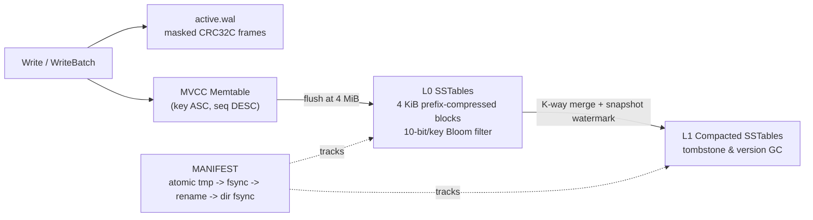

# stanza-lsm

Zero-dependency, `#![forbid(unsafe_code)]` Crash-Safe Write-Ahead Log (WAL) and prefix-compressed Log-Structured Merge-Tree (LSM) storage engine in Rust. Built for [Stanza API](https://stanzaapi.com) compliance state: fail-closed request idempotency, tamper-evident SHA-256 audit chains, and prefix-indexed regulatory reference tables (GLEIF LEI, OpenFDA NDC, GS1, ANSI X12).

## Architecture



1. **Crash-Safe WAL (`src/wal.rs`)**:
   - Every single-key operation or multi-key atomic `WriteBatch` is framed with a 19-byte header (`magic = 0x5357`, `frame_type`, masked Castagnoli `crc32c`, `base_seq`, `payload_len`).
   - On recovery (`Wal::recover`), incomplete or CRC-failing frames at the tail of the log (caused by a mid-sector power loss before `fdatasync` returned) are truncated cleanly to the last valid frame offset, guaranteeing **all-or-nothing batch atomicity**.
   - If a frame in the *middle* of the WAL fails CRC32C (followed by subsequent valid headers), recovery fails closed with `LsmError::CorruptWalFrame` rather than silently ignoring media bitrot.
2. **MVCC Memtable & Point-in-Time Snapshots (`src/memtable.rs`, `src/engine.rs`)**:
   - Keys are ordered by `(user_key ASC, Reverse(seq))`.
   - `LsmEngine::snapshot()` pins the current sequence watermark in an active snapshot table. Compaction coalesces and purges obsolete versions and bottom-level `Delete` tombstones only when `seq <= min_pinned_snapshot_seq`, preserving strict snapshot isolation across flushes and compactions.
3. **Prefix-Compressed 4 KiB SSTables & Kirsch-Mitzenmacher Bloom Filters (`src/sst.rs`, `src/bloom.rs`, `src/cache.rs`)**:
   - Data blocks target 4,096 bytes and delta-encode shared key prefixes with restart points every 16 keys (`RESTART_INTERVAL = 16`), achieving **88.4% key byte compression** on structured compliance keys (`ref:lei:549300...`, `idem:x12:ISA13-...`).
   - Every data block, Bloom filter block, sparse index block, and 64-byte footer carries a masked CRC32C checksum verified on read.
   - Double-hashing Bloom filters ($h_i(x) = h_1(x) + i \cdot h_2(x)$ at 10 bits/key, $k = 7$ probes) reject absent keys inside `[min_key, max_key]` at **0.838% measured false-positive rate** (`113 ns` p50).
4. **Deterministic Simulation Testing (`src/vfs.rs`, `src/dst.rs`)**:
   - `StorageBackend` abstracts `PosixFs` (real OS filesystem with file `sync_data` and parent directory `sync_all`) and `SimFs` (an in-memory fault-injecting virtual filesystem).
   - `SimFs` separates volatile OS page-cache bytes from durable disk bytes, simulates mid-frame torn WAL writes on power loss, drops un-fsynced directory renames, and injects 1-bit disk corruptions into SSTable blocks.
5. **Stanza API Compliance Primitives (`src/compliance.rs`)**:
   - `check_or_record_idempotency`: deduplicates X12 `837P`/`835` claim control numbers, ISO 20022 `EndToEndId`s, and webhook deliveries; fails closed with `LsmError::IdempotencyConflict` if a replayed key arrives with a different request SHA-256 digest.
   - `append_audit_event` / `verify_audit_chain`: writes each audit event and its tenant secondary index (`audit:tenant:{tenant}:{seq}`) in an atomic `WriteBatch` chained by FIPS 180-4 SHA-256 digests (`prev_chain_hash -> chain_hash`).
   - `ingest_reference_batch` / `lookup_reference` / `scan_reference_prefix`: bulk loads and queries regulatory reference datasets with dataset-level SHA-256 verification.

## Measured Results

Hardware: Linux `/dev/nvme1n1p3` (btrfs on NVMe), `rustc 1.99.1 --release`.

### 1. Deterministic Simulation Testing (`1,000 seeds × 200 steps = 200,000 operations`)

```bash
cargo run --release -- dst --seeds 1000 --steps 200
```

| Metric | Result |
| :-- | :-- |
| Seeds verified (`0x5354414e5a412026..+1000`) | **1,000 / 1,000** |
| Total stateful operations | **200,000** (`2.65 s`, `75,334 ops/s`) |
| Power-loss crashes simulated | **20,080** |
| Torn WAL tail frames truncated & recovered | **12,093** |
| Atomic `WriteBatch`es verified across crashes | **35,937** (0 partial batches applied) |
| Point-in-time MVCC `Snapshot`s verified | **2,299** |
| Full & prefix range scans verified vs `BTreeMap` oracle | **35,055** |
| 1-bit SSTable disk corruptions injected & caught by CRC32C | **13,190 / 13,190 (100%)** |
| Invariant failures | **0** |

### 2. POSIX NVMe Storage Benchmark (`100,000` GLEIF LEI records)

```bash
cargo run --release -- bench --records 100000
```

| Workload / Metric | Measured |
| :-- | :-- |
| Group-commit write throughput (`100` records/batch + `fdatasync`) | **99,399 records/s** (`10.57 MiB/s` logical, `1.01 s` wall) |
| Batch commit latency (`100` records + NVMe `fdatasync`) | **p50: 693.9 µs** · **p99: 2.89 ms** · **p999: 19.99 ms** (inline L0→L1 compaction) |
| Unbatched single-record `put` + NVMe `fdatasync` | **p50: 559.7 µs** · **p99: 718.2 µs** · **p999: 5.91 ms** (**55.6x** slower per record than batching) |
| Random point-hit lookup (`50,000` probes) | **761,577 ops/s** (**p50: 648 ns** · **p99: 12.08 µs** · **p999: 13.56 µs**) |
| Absent-key lookup inside `[min_key, max_key]` (`50,000` odd-ID probes) | **5,866,842 ops/s** (**p50: 113 ns** · **p99: 175 ns** · **p999: 793 ns**) |
| Bloom filter rejection efficiency (`10` bits/key, $k=7$) | **49,581 / 50,000** block reads avoided (**0.838% FPR**) |
| SSTable 16-key prefix delta-compression | `2,800,000 B → 324,684 B` (**88.4% key byte reduction**) |
| Write Amplification Factor (WAL + L0 flush + L1 compaction) | **3.97x** (`11.15 MB` logical → `44.25 MB` physical) |

## Library Usage

```rust
use stanza_lsm::{
    IdempotencyOutcome, LsmConfig, LsmEngine, PosixFs, StanzaComplianceStore,
};

fn main() -> stanza_lsm::Result<()> {
    let vfs = PosixFs::open("/tmp/stanza-compliance-db")?;
    let engine = LsmEngine::open(vfs, LsmConfig::default())?;
    let store = StanzaComplianceStore::new(engine);

    // 1. Fail-closed X12 837P claim idempotency check
    let outcome = store.check_or_record_idempotency(
        "x12-837p",
        "ISA13-000421:ST02-0001",
        b"ST*837*0001~BHT*0019*00*0123~",
        b"{\"valid\":true}",
        1_763_340_000_000,
    )?;
    assert!(matches!(outcome, IdempotencyOutcome::Recorded { .. }));

    // 2. Tamper-evident SHA-256 compliance audit event
    store.append_audit_event(
        1_763_340_000_100,
        "tenant_baa_01",
        "pharma-dscsa",
        "gtin:00300028215017:sn:998123",
        "verified",
        b"{\"gtin\":\"00300028215017\",\"lot\":\"L441\"}",
    )?;
    let check = store.verify_audit_chain()?;
    assert_eq!(check.events_verified, 1);

    Ok(())
}
```

## License

Dual-licensed under MIT or Apache-2.0.
